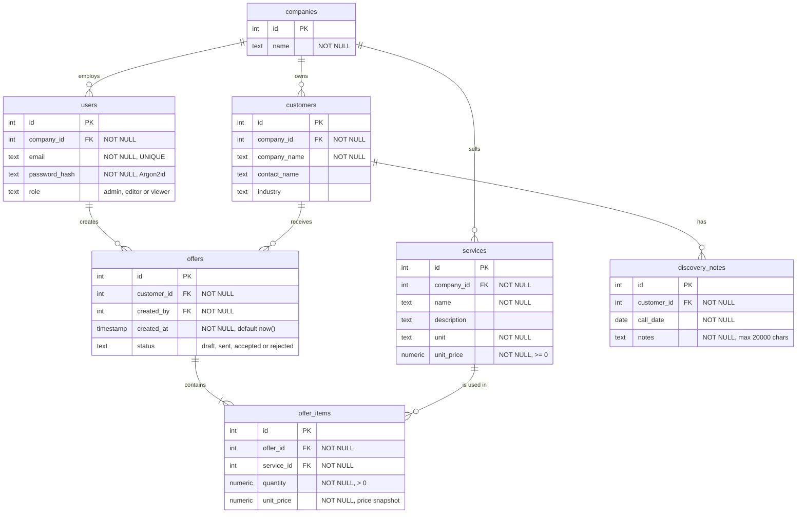

# ER Model

> Diagram drafted with AI assistance (Claude) from `schema.sql`, reviewed by me.

## Relationships

| From | To | Cardinality | Via |
|---|---|---|---|
| companies | users | 1 : n | `users.company_id` |
| companies | customers | 1 : n | `customers.company_id` |
| companies | services | 1 : n | `services.company_id` |
| users | offers | 1 : n | `offers.created_by` |
| customers | discovery_notes | 1 : n | `discovery_notes.customer_id` |
| customers | offers | 1 : n | `offers.customer_id` |
| offers | offer_items | 1 : n (at least one item) | `offer_items.offer_id` |
| services | offer_items | 1 : n | `offer_items.service_id` |
| **offers** | **services** | **n : m** | junction table `offer_items` |

## Indexes

| Index | Column | Status |
|---|---|---|
| Primary key index | `id` in every table | ✅ created automatically by PostgreSQL |
| Foreign key index | `offers.customer_id` | ⏳ planned (list offers per customer) |
| Foreign key index | `offer_items.offer_id` | ⏳ planned (load items of an offer) |
| Foreign key index | `discovery_notes.customer_id` | ⏳ planned (notes per customer) |
