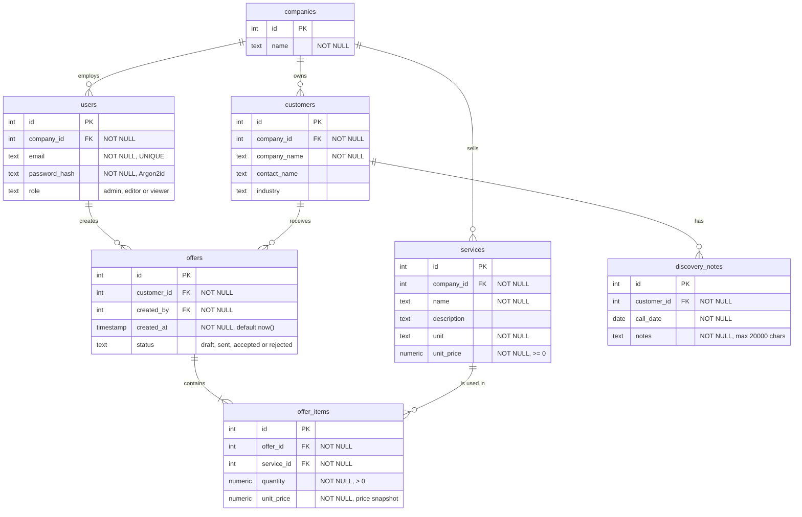

# ER Model

> Diagram drafted with AI assistance (Claude) from `schema.sql`, reviewed by me.

## Relationships

| From | To | Cardinality | Via |
|---|---|---|---|
| companies | users | 1 : n | `users.company_id` |
| companies | customers | 1 : n | `customers.company_id` |
| companies | services | 1 : n | `services.company_id` |
| users | offers | 1 : n | `offers.created_by` |
| customers | discovery_notes | 1 : n | `discovery_notes.customer_id` |
| customers | offers | 1 : n | `offers.customer_id` |
| offers | offer_items | 1 : n (at least one item) | `offer_items.offer_id` |
| services | offer_items | 1 : n | `offer_items.service_id` |
| **offers** | **services** | **n : m** | junction table `offer_items` |

## Indexes

| Index | Column | Status |
|---|---|---|
| Primary key index | `id` in every table | created automatically by PostgreSQL |
| Unique index | `users.email` | created automatically by `UNIQUE` |
| `idx_services_company_id` | `services.company_id` | implemented (load the services of one company) |
| `idx_offers_customer_id` | `offers.customer_id` | implemented (list offers per customer) |
| `idx_offer_items_offer_id` | `offer_items.offer_id` | implemented (load items of an offer, offer total) |
| `idx_discovery_notes_customer_id` | `discovery_notes.customer_id` | implemented (notes per customer) |

PostgreSQL creates indexes for primary keys and `UNIQUE` columns automatically, but **not for foreign keys**.
The four indexes above cover the columns the app filters and joins by. With the small test data set
the planner may still choose a sequential scan; the indexes matter once there are thousands of rows.
