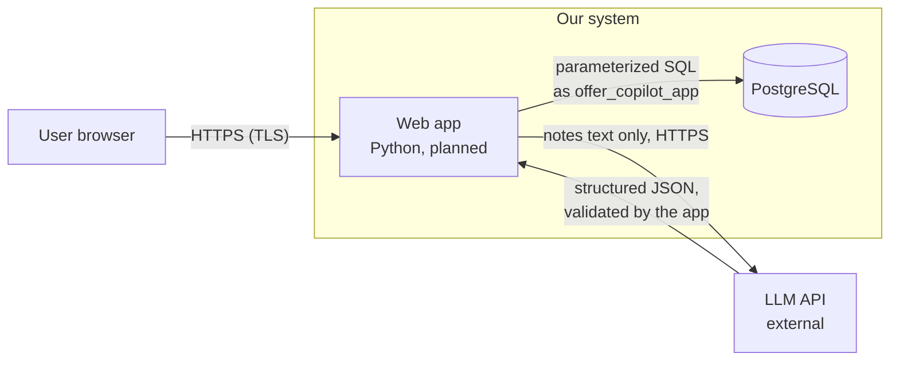

# Threat Model — Offer Copilot

> §1–3 and §5–7 are based on my own answers, wording edited with AI assistance (Claude).
> §4 and §8–12 and the data flow diagram were drafted with AI assistance and reviewed by me.
> Some of the implemented measures (`roles.sql`, `.gitignore`, `.env.example`, `users`/`companies` tables)
> were drafted with AI assistance and reviewed and tested by me.
>
> **Scope:** the database layer is implemented; the web app, the login and the LLM integration are
> planned. Every item is marked as implemented or planned.

## Implemented security measures

| Measure | Where | Protects | Verified |
|---|---|---|---|
| Allowlist for offer status | `schema.sql` — `CHECK (status IN (...))` | Integrity | Insert with `status = 'hacked'` is rejected |
| Size limit for discovery notes | `schema.sql` — `CHECK (char_length(notes) <= 20000)` | Availability, LLM costs | Insert with 20,001 characters is rejected |
| Value checks and required fields | `schema.sql` — `CHECK`, `NOT NULL`, foreign keys | Integrity | — |
| Price snapshot per offer item | `schema.sql` — `offer_items.unit_price` | Integrity of sent offers | — |
| Role-based access control (data model) | `schema.sql` — `users.role` with `CHECK (role IN ('admin', 'editor', 'viewer'))`, default `viewer` | Authorization | Insert with `role = 'superadmin'` is rejected |
| Tenant model | `schema.sql` — `companies` table, `company_id` on `users`, `customers`, `services` | Confidentiality between companies | — |
| One account per email | `schema.sql` — `users.email UNIQUE` | Authenticity | Duplicate email is rejected |
| Creator recorded per offer | `schema.sql` — `offers.created_by` | Non-repudiation | — |
| Least-privilege database role | `roles.sql` — `offer_copilot_app` may only `SELECT`, `INSERT`, `UPDATE` | Integrity, limits damage of SQL injection | `DELETE`, `DROP TABLE` and `CREATE TABLE` are denied |
| Secrets kept out of the repo | `.gitignore` (`.env`), `.env.example` without real values | Confidentiality | Git history contains no secrets |
| Push protection for secrets | GitHub — push protection enabled on my account (blocks pushes containing known secret formats) | Confidentiality | — |
| Database backup with tested restore | `pg_dump -Fc` / `pg_restore` (see §8) | Availability | Restore into a fresh database succeeded |

## 1. System overview
Offer Copilot creates offer drafts for architects in the DACH region. The user enters the notes
from a discovery call (e.g. transcribed voice notes), an LLM extracts the customer's needs and
selects matching services, and the offer is calculated from the database.

**Components**
- **User (browser)** — enters notes and reviews offers
- **Web app (Python)** — business logic, validation, access control *(planned)*
- **PostgreSQL** — customers, services and prices, discovery notes, offers
- **LLM API (external provider)** — extracts needs from the notes. This is the point where
  customer data leaves the system.

**Data flow and trust boundaries**

Everything that crosses the boundary of "Our system" is untrusted: input from the browser and
output from the LLM. The LLM never talks to the database directly.

## 2. Assets
| Asset | Why it needs protection |
|---|---|
| Discovery notes | Confidential information about customers and their projects |
| Services and prices | Must not be manipulated — wrong prices mean wrong offers (integrity) |
| Offers | Business data of the user and their customers |
| User accounts and passwords | `users` table exists; passwords are only stored as Argon2id hash (login itself is planned) |
| Secrets | Database password and LLM API key |

## 3. Security goals
| Goal | Meaning | In Offer Copilot |
|---|---|---|
| **Confidentiality** | Only authorized parties can **read** the data | Discovery notes are only visible to the responsible user — not to other users, and the LLM provider must not use them for training |
| **Integrity** | Data cannot be **changed** without authorization or unnoticed | Only admins can change prices. A sent offer keeps its prices thanks to the price snapshot in `offer_items.unit_price` |
| **Availability** | The system and its data are **usable when needed** | Rate limiting against bot traffic; database backups to recover from data loss |
| **Authenticity** | It can be verified that someone or something **is who they claim to be** | Login verifies the user *(planned)*; the TLS certificate proves the server is ours |
| **Non-repudiation** | Someone **cannot deny** having performed an action | Log who created an offer or set it to "sent", and when *(planned)*; strongest form: digital signature |

## 4. Entry points
Places where data or requests enter the system. Each one is a possible attack surface.

| Entry point | Who uses it | Trust | Status |
|---|---|---|---|
| Direct database access (`psql`) | Developer only, locally | Trusted, but app work uses the least-privilege role `offer_copilot_app` | implemented |
| Login form (`POST /login`) | Anyone on the internet | Untrusted — target of brute force and credential stuffing | planned |
| CRUD forms and endpoints (customers, services, discovery notes, offers) | Logged-in users | Untrusted input — every request passes the access check (§6) and validation (§7) | planned |
| Discovery notes text | Logged-in editors | Untrusted free text — may contain prompt injection | planned |
| LLM response | External LLM provider | Untrusted — treated like user input | planned |
| Configuration (`.env`) | Developer / server | Contains secrets, never in the repo | implemented |

## 5. Authentication
**Status:** `users` table with `password_hash` implemented · login flow planned.

**Common methods:** password + secure hashing · 2FA / MFA (TOTP app, security key; SMS is the
weakest option because of SIM swapping) · passkeys (WebAuthn) · login via an identity provider
(OpenID Connect) · magic links (only as secure as the email account).

**Planned for Offer Copilot** — one of two options, decision open:
1. **Email + password + TOTP** — passwords hashed with **Argon2id** and a per-user salt, never
   stored in plain text; second factor via an authenticator app (TOTP).
2. **Login via an identity provider (OpenID Connect)**, e.g. Google or Microsoft — Offer Copilot stores no passwords at all; the provider
   handles login and 2FA.

After login, the user session is kept in a cookie with `HttpOnly`, `Secure` and `SameSite` set.

**OAuth 2.0 vs. OpenID Connect (relevant for option 2)**
- **OAuth 2.0** is an *authorization* protocol: a user lets an app access their data at another
  service via a short-lived **access token** with limited **scopes** — without sharing the password.
- **OpenID Connect** adds *authentication* on top: with the scope `openid`, the provider also returns
  an **ID token** — a JWT signed by the provider that states who the user is (`sub`, `email`).
- Offer Copilot would use the **Authorization Code Flow with PKCE** and verify the ID token's
  signature, issuer (`iss`), audience (`aud`) and expiry (`exp`) before creating a session.

## 6. Authorization
**Status:** data model implemented in `schema.sql` · enforcement in the app planned.

**Common models:** RBAC (rights attached to roles) · ABAC (rules over attributes of user, object
and context) · ReBAC (rights derived from relationships, e.g. team membership) · ACLs (per-object
lists of who may do what). OAuth 2.0 covers authorization *between* apps, not inside one.

**Offer Copilot uses RBAC plus a tenant check:**

| Role | Permissions |
|---|---|
| **admin** | everything an editor can do + manage services and prices + manage users and their roles |
| **editor** | create and edit customers, discovery notes and offers |
| **viewer** | read customers, discovery notes and offers |

- **Roles in the database:** `users.role` with `CHECK (role IN ('admin', 'editor', 'viewer'))`, default
  `viewer` (least privilege). Implemented.
- **Tenant isolation:** users only ever see data of **their own company**. `users`, `customers` and
  `services` carry a `company_id` (implemented); every query will be filtered by the user's company (planned) — changing
  `/offers/12` to `/offers/13` must not reveal another company's offer (broken access control).
- **Central decision point:** one access check in the backend that every request passes through —
  never only in the frontend (hiding a button is not access control).
- **Deny by default:** anything not explicitly allowed for a role is forbidden.
- **No privilege escalation:** only admins can change roles; users cannot change their own role.

## 7. Input validation
**What:** every input is checked automatically against what is expected — type, range, length,
format, allowed values, existence — and **rejected** if it does not match.

**Why:** many attacks are manipulated input (SQL injection, XSS, prompt injection); invalid data
breaks integrity (e.g. negative quantities → wrong offers); oversized input threatens availability.

**Rules:** always validate **server-side** (browser checks are only UX) · **allowlist** what is allowed
instead of blocklisting what looks dangerous · validation is **one layer** — SQL injection is
additionally prevented by parameterized queries (defense in depth).

| Input | Validation | Status |
|---|---|---|
| `offer_items.quantity` | `CHECK (quantity > 0)` in the database | implemented |
| `services.unit_price` | `CHECK (unit_price >= 0)` in the database | implemented |
| Required fields | `NOT NULL` constraints | implemented |
| References (`customer_id`, `offer_id`, `service_id`) | foreign keys — referenced row must exist | implemented |
| `offers.status` | `CHECK` — only `draft`, `sent`, `accepted`, `rejected` | implemented |
| `discovery_notes.notes` | `CHECK (char_length(notes) <= 20000)` | implemented |
| Discovery notes via the app | valid `call_date`, length check before the LLM call (Pydantic) | planned |
| **LLM output** | fixed schema via Pydantic; every `service_id` must exist in the database; the LLM never sets prices | planned |

## 8. Data protection
**Encryption in transit** (planned) — all traffic between browser and app, and between app and LLM API, uses
**TLS (HTTPS)**. TLS uses asymmetric cryptography to authenticate the server (certificate signed by a
certificate authority) and to agree on a session key, then fast **symmetric** encryption for the data itself.
The connection between app and database also uses TLS once they run on different machines.

**Encryption at rest** (planned) — the production database and backups are stored on an encrypted disk;
backups are additionally encrypted (BorgBackup) before they leave the server.

**Passwords** (planned) — only stored as **Argon2id** hash with a per-user salt (column `users.password_hash` exists).
Argon2id is deliberately slow, which makes brute force on a leaked database expensive.

**Data sent to the LLM provider** (planned) — discovery notes are customer data. Rules:
- send only the notes text needed for extraction — no email addresses, no user data, no prices
- use a provider with a **data processing agreement (DPA)** that does not train on API data (GDPR)
- the LLM gets **no database access** and no secrets; it only returns structured output

**Backup and restore** (implemented)
```bash
pg_dump -Fc offer_copilot -f offer_copilot.dump        # backup
createdb offer_copilot_restore && pg_restore -d offer_copilot_restore offer_copilot.dump   # restore
```
Planned: run daily via cron, store encrypted outside the server (e.g. BorgBackup).

**Secrets** (implemented) — database URL and LLM API key live in `.env`, which is git-ignored.

## 9. Network & deployment
**Current state** — everything runs locally; nothing is reachable from the internet.

**Planned production setup**
- Only ports **443 (HTTPS)** and **22 (SSH)** open to the internet; port 80 only redirects to 443.
- **PostgreSQL is not reachable from the internet** — it listens only on localhost / the private network,
  port 5432 is blocked by the firewall.
- **SSH** with key-based login only; password login and root login disabled.
- **Rate limiting** on the login and on the LLM endpoint against bots and cost abuse — per account as well
  as per IP, because many users can share one IP (carrier-grade NAT).
- IP (network layer) itself offers no confidentiality or integrity — protection comes from TLS on top
  and from the firewall rules above.

## 10. Dependencies
Every dependency increases the attack surface, so the list is kept short.

| Dependency | Purpose | Status |
|---|---|---|
| PostgreSQL | Database | in use |
| GitHub | Code hosting, push protection | in use |
| Python web framework, `psycopg`, Pydantic, `argon2-cffi` | App, DB driver, validation, password hashing | planned |
| LLM API (external provider) | Extraction from discovery notes | planned |

**Patch process** (planned) — versions pinned in `requirements.txt`; **Dependabot** and `pip-audit` report
known vulnerabilities; deploys are scripted so a patch can be shipped within hours.

## 11. Threats & mitigations
| Threat | Impact | Mitigation | Status |
|---|---|---|---|
| **SQL injection** — attacker puts SQL into an input field | Read or change any data | Parameterized queries only (input is never concatenated into SQL); least-privilege role limits damage (no `DELETE`/`DROP`) | implemented: role · planned: queries |
| **Broken access control** — user changes `/offers/12` to `/offers/13` | Sees another company's offers | Central access check; every query filtered by `company_id`; RBAC; deny by default | implemented: data model · planned: enforcement |
| **Brute force / credential stuffing** on the login | Account takeover | Argon2id, rate limiting, 2FA (TOTP) or login via OpenID Connect | planned |
| **CSRF** — another website makes the logged-in user's browser send a request | Unwanted actions, e.g. changed prices | `SameSite` cookies + CSRF token in every form | planned |
| **Prompt injection** — notes contain "ignore your instructions…" | Wrong services in an offer | LLM has no DB access and no tools; output validated against a schema; every `service_id` must exist; prices always come from the DB; user reviews every draft | planned |
| **Leaked secrets** (DB password, API key) | Full data access, LLM costs | `.env` git-ignored, push protection on GitHub; rotate keys if leaked | implemented |
| **Manipulated prices** | Wrong offers, financial damage | Only admins edit services; `CHECK (unit_price >= 0)`; price snapshot in `offer_items` | implemented: DB · planned: role check |
| **Invalid or oversized data** | Broken offers, high LLM costs | `CHECK` constraints, `NOT NULL`, foreign keys, 20,000-character limit | implemented |
| **Data loss** (ransomware, mistake, hardware failure) | System unusable | `pg_dump` backup, restore tested; planned: daily, encrypted, off-site | implemented: tested · planned: automated |
| **Customer data misused by the LLM provider** | Confidentiality, GDPR violation | Data minimization, provider with DPA and no training on API data | planned |

## 12. Open risks
What is **not** protected yet, and why that is acceptable at this stage.

- **No web app and no login yet** — authentication and authorization exist only in the data model.
  Acceptable because the system only runs locally with seed data; no real customer data is stored.
- **Local Postgres uses `trust` authentication** (Homebrew default), so the app role logs in without a
  password. In production: `scram-sha-256` in `pg_hba.conf` and the password from `.env`.
- **Tenant isolation is not enforced by the database itself.** `discovery_notes` and `offers` belong to a
  company only via `customers`, so one forgotten filter could leak data. Next step: PostgreSQL
  **row-level security**.
- **The app role may `UPDATE` every column**, including `users.role`. Privilege escalation is only
  prevented by the planned app logic; column-level grants would harden this.
- **No audit log yet** — `offers.created_by` records the creator, but not who changed an offer or a price later.
- **No incident response plan written down yet.** Minimum: who decides, take the system offline or lock
  the attacker out, inform affected customers quickly (GDPR: report to the authority within 72 hours),
  use the BSI templates.
